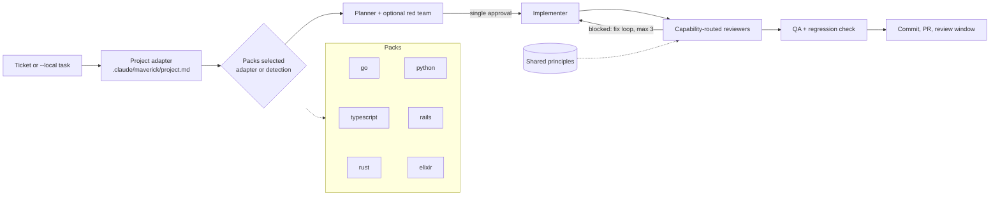

# Maverick
My personal AI coding configuration with MCPs, skills, commands, agent packs, and workflows for Claude Code and Codex.

[](https://github.com/igorvieira/maverick/actions/workflows/test.yml)


## Install

One command per machine, one per repo. No UI, no Rust toolchain needed.

```bash
# 1. Once per machine: clones into ~/.local/share/maverick, adds `maverick-setup` to ~/.local/bin,
#    and configures Claude Code and/or Codex if they are installed.
curl -fsSL https://raw.githubusercontent.com/igorvieira/maverick/main/install.sh | bash

# 2. Once per repo: packs are detected from the repo's files.
cd /path/to/your/repo && maverick-setup project
```

Re-run step 1 at any time to update. Then fill **only** `.claude/maverick/project.md` with
this repo's facts (commands, layout, accepted variants, ticket prefix). No secrets. Open
the repo in Claude Code or Codex and run:

```text
/maverick TICKET-123
/maverick --local "Add dark mode toggle"
```

| You want | Command |
|---|---|
| Install or update Maverick on this machine | `curl -fsSL …/install.sh \| bash` |
| Workflow + detected packs in the current repo | `maverick-setup project` |
| Choose packs explicitly | `maverick-setup project . --pack typescript --pack rust` |
| Configure a CLI installed later | `maverick-setup claude` or `maverick-setup codex` |
| Install somewhere else / another branch | `MAVERICK_HOME=~/tools/maverick MAVERICK_REF=my-branch bash install.sh` |

Requirements: `git` and `bash`. `jq` is used for Claude MCP setup and pack detection
(without it, pass `--pack` explicitly). Working from a clone instead? `./setup.sh` accepts
the same arguments as `maverick-setup`.

### Discord via Hermes (optional)

Send tasks from a Discord channel and get PRs back, with **one** interruption per task: the plan.
[Hermes Agent](https://github.com/NousResearch/hermes-agent) is the dispatcher; Claude Code, Codex
or Grok do the work through `/maverick --unattended`.

```bash
./setup.sh hermes   # skill + maverick-dispatch/maverick-report + ~/.config/maverick/dispatch.json
```

```
#maverick  "api: fix the login timeout"        → thread, worktree, plan (🔕 silent progress)
           @you plan ready — answer once        → "ok" / "ok, 1: use X" / "redo"
           (autonomous: implement → QA → PR)   → 🔕 silent phase reports via webhook
           @you ✅ PR #42                       (or ⚠️ draft PR with the blocker — never a question)
```

Prefixes: `[codex]` / `[grok]` picks the executor, `<repo>:` picks a repo from `dispatch.json`.
The setup prints the `~/.hermes/config.yaml` snippet; the bot token and the channel webhook stay in
`~/.hermes/.env` and `~/.config/maverick/secrets.env`, never in this repo.

For Codex, also copy `codex/AGENTS.md` into the consuming repo if you want the project template. The experimental Rust binary is optional and is not part of this install; see [Experimental Rust Runtime](#experimental-rust-runtime).

## Personal knowledge (optional)

Keep your own playbooks in `.knowledge/` at the root of this checkout (git-ignored) with an
`index.json` that maps each file to capabilities like `payments` or `pagination`. Project
installs link it, and the planner feeds matching entries to the implementer and reviewers.
Format and options: [docs/knowledge.md](docs/knowledge.md).

## The Three Layers

Maverick is **project-agnostic and language-agnostic** by construction. It separates:

| Layer | Lives in | Provides |
|---|---|---|
| **Core workflow** | `claude/skills/maverick/SKILL.md` | phases, single approval checkpoint, parallel worktrees, QA gates, delivery, PR + review window |
| **Language packs** | `claude/agents/<pack>/` | specialist agents for a language (planner, red team, implementer, reviewer panel) |
| **Shared principles** | `claude/principles/` | language-neutral backend rules (domain, flow, adapters, eventing, architecture, red team) the packs apply |
| **Project adapter** | `.claude/maverick/project.md` *in your repo* | YOUR repo's facts: build/test commands, layout, migrations, conventions, ticket prefix |

Project-specific knowledge never lives in this repository — it lives in each consuming repo's
adapter file. That keeps Maverick reusable across companies and codebases without leaking
anything private. A CI deny-list enforces it.

## Structure

```
maverick/
├── claude/                       # Claude Code configuration assets
│   ├── mcp-servers/              # Claude MCP server JSON snippets
│   │   ├── global.json           # Global MCPs (serena, figma)
│   │   └── project.json          # Per-project MCPs
│   ├── skills/
│   │   └── maverick/
│   │       └── SKILL.md          # Core workflow (single source of truth)
│   ├── principles/               # Shared, language-neutral backend rules
│   │   ├── README.md             # Adapter overrides: accepted variants, diff-only review
│   │   ├── domain.md
│   │   ├── application-flow.md
│   │   ├── adapters.md
│   │   ├── eventing.md
│   │   ├── architecture.md
│   │   └── red-team.md
│   ├── agents/                   # One directory per language pack
│   │   ├── go/                   # Go: DDD + Clean Architecture, rules inline
│   │   │   ├── pack.json                     # Manifest: detection, commands, reviewer routing
│   │   │   ├── pack.md                       # Compatibility pointer only
│   │   │   ├── go-task-scope-planner.md
│   │   │   ├── go-implementer.md
│   │   │   ├── go-adversarial-architect.md
│   │   │   ├── go-idiom-reviewer.md
│   │   │   ├── go-domain-model-reviewer.md
│   │   │   ├── go-application-flow-reviewer.md
│   │   │   ├── go-adapter-reviewer.md
│   │   │   ├── go-eventing-reviewer.md
│   │   │   └── go-arch-reviewer.md
│   │   ├── typescript/           # Node.js backend + frontend (TypeScript)
│   │   │   ├── pack.json                     # Manifest: detection, commands, reviewer routing
│   │   │   ├── pack.md                       # Compatibility pointer only
│   │   │   ├── typescript-task-scope-planner.md
│   │   │   ├── typescript-implementer.md
│   │   │   ├── typescript-adversarial-architect.md
│   │   │   ├── typescript-type-safety-reviewer.md
│   │   │   ├── typescript-frontend-reviewer.md
│   │   │   ├── typescript-contract-reviewer.md
│   │   │   ├── typescript-domain-reviewer.md
│   │   │   ├── typescript-application-flow-reviewer.md
│   │   │   ├── typescript-adapter-reviewer.md
│   │   │   ├── typescript-eventing-reviewer.md
│   │   │   └── typescript-arch-reviewer.md
│   │   ├── rust/                 # Rust
│   │   │   ├── pack.json                     # Manifest: detection, commands, reviewer routing
│   │   │   ├── pack.md                       # Compatibility pointer only
│   │   │   ├── rust-task-scope-planner.md
│   │   │   ├── rust-implementer.md
│   │   │   ├── rust-adversarial-architect.md
│   │   │   ├── rust-idiom-reviewer.md
│   │   │   ├── rust-domain-reviewer.md
│   │   │   ├── rust-application-flow-reviewer.md
│   │   │   ├── rust-adapter-reviewer.md
│   │   │   ├── rust-eventing-reviewer.md
│   │   │   └── rust-arch-reviewer.md
│   │   ├── python/               # Python
│   │   │   ├── pack.json                     # Manifest: detection, commands, reviewer routing
│   │   │   ├── pack.md                       # Compatibility pointer only
│   │   │   ├── python-task-scope-planner.md
│   │   │   ├── python-implementer.md
│   │   │   ├── python-adversarial-architect.md
│   │   │   ├── python-idiom-reviewer.md
│   │   │   ├── python-domain-reviewer.md
│   │   │   ├── python-application-flow-reviewer.md
│   │   │   ├── python-adapter-reviewer.md
│   │   │   ├── python-eventing-reviewer.md
│   │   │   └── python-arch-reviewer.md
│   │   ├── rails/                # Ruby on Rails
│   │   │   ├── pack.json                     # Manifest: detection, commands, reviewer routing
│   │   │   ├── pack.md                       # Compatibility pointer only
│   │   │   ├── rails-task-scope-planner.md
│   │   │   ├── rails-implementer.md
│   │   │   ├── rails-adversarial-architect.md
│   │   │   ├── rails-idiom-reviewer.md
│   │   │   ├── rails-domain-reviewer.md
│   │   │   ├── rails-application-flow-reviewer.md
│   │   │   ├── rails-adapter-reviewer.md
│   │   │   ├── rails-eventing-reviewer.md
│   │   │   └── rails-arch-reviewer.md
│   │   └── elixir/               # Elixir / Phoenix / OTP
│   │       ├── pack.json                     # Manifest: detection, commands, reviewer routing
│   │       ├── pack.md                       # Compatibility pointer only
│   │       ├── elixir-task-scope-planner.md
│   │       ├── elixir-implementer.md
│   │       ├── elixir-adversarial-architect.md
│   │       ├── elixir-idiom-reviewer.md
│   │       ├── elixir-domain-reviewer.md
│   │       ├── elixir-application-flow-reviewer.md
│   │       ├── elixir-adapter-reviewer.md
│   │       ├── elixir-eventing-reviewer.md
│   │       └── elixir-arch-reviewer.md
│   ├── commands/                 # Claude Code slash commands
│   │   ├── maverick.md           # Thin /maverick entry point (delegates to the skill)
│   │   ├── maverick-single.md    # Worktree unit of execution
│   │   ├── review-resolver.md
│   │   ├── senior-architect.md
│   │   ├── senior-frontend.md
│   │   ├── senior-security.md
│   │   └── senior-qa.md
│   └── templates/
│       ├── maverick-project.md   # Project adapter template (fill per repo)
│       └── linear-figma.md
├── codex/                        # Codex configuration assets
│   ├── AGENTS.md
│   ├── config/config.toml.example
│   └── skills/maverick/SKILL.md
├── hermes/                       # Hermes dispatcher: skill, maverick-dispatch, maverick-report
├── install.sh                    # One-step machine installer (curl | bash)
├── setup.sh                      # Installer (global, codex, and per-project)
└── test_setup.sh                 # Test suite for setup scripts
```

## Experimental Rust Runtime

The Rust runtime is **experimental**. This first vertical slice provides a local,
typed execution kernel: run identity, an explicit state machine, validated transitions,
SQLite persistence, append-only transition history, versioned JSON artifacts, and
structured review results. The CLI records lifecycle steps explicitly; it does not
perform the work described by those steps.

**Markdown skills remain the current workflow interface.** The existing commands,
language packs, project adapters, and installers retain their existing workflow. They
do not drive the Rust lifecycle automatically; pack inspection is available separately. This foundation does not make the Maverick workflow
independent of Claude Code or Codex.

Agent execution, runtime-managed worktrees, scheduler, policy engine, and LLM
completions are **not implemented**. Model setup only discovers local CLIs and
persists a provider list. Approval authorization, required-artifact gates and automatic fix loops are also future integration work. A typed review's
`is_blocking()` returns true for `fail` status or a `blocker`/`high` finding; the CLI
validates review JSON but does not yet enforce review results as transition gates.
No agent semantics or project knowledge have moved into Rust.

### Crates and dependencies

| Crate | Responsibility |
|---|---|
| `crates/maverick-core` | Run model, transition validation, artifact/review/pack/model-setup contracts, capability routing and aggregation; independent of SQLite and CLI |
| `crates/maverick-store` | Local SQLite index, transactional state/history, artifact files and restart recovery |
| `crates/maverick-cli` | Clap JSON commands, pack inspection, Ratatui model setup, local CLI discovery |
| `crates/maverick-packs` | Declarative pack loading, agent-reference checks, file detection and explicit selection |

Dependencies are limited to Serde/JSON/TOML (contracts), UUID v4 (run IDs), thiserror
(typed library errors), rusqlite with bundled SQLite (no database service or system
SQLite requirement), tempfile (atomic file publication and test isolation), clap
(arguments), anyhow (CLI error context), and Ratatui/Crossterm (interactive setup).
`Cargo.lock` is committed. The runtime makes no network calls and does not invoke
LLM completions. Discovery may run local `grok models` / `ollama list` when those
binaries exist; it never stores secrets, only env var names.

### Build and test

Install a stable Rust toolchain with `rustfmt` and `clippy`, plus a C compiler for
bundled SQLite. Building for the first time needs access to crates.io; subsequent
CLI operations are local. The existing setup tests also require Bash and jq.

```bash
cargo build --workspace
cargo fmt --all -- --check
cargo clippy --workspace --all-targets --all-features -- -D warnings
cargo test --workspace --all-features
bash test_setup.sh
```

Use `target/debug/maverick`, or install the binary with
`cargo install --path crates/maverick-cli --locked` to use `maverick` on your PATH.
The existing `setup.sh` does not install the experimental runtime.

### Model setup TUI

`maverick` with no subcommand opens a [Ratatui](https://ratatui.rs/) setup when stdout
is a TTY. `maverick setup` is the same. Non-TTY sessions print a hint and exit 2;
use `maverick models` for JSON. The TUI discovers Grok/Claude/Codex/Ollama on PATH,
lets you set a default, mark a **planner panel** of one or more models, and add an
OpenAI-compatible or xAI API provider. Grok is a provider implementation, not the
runtime's internal model. Config is written to `$MAVERICK_CONFIG` or
`~/.config/maverick/config.toml`; an optional `.maverick/config.toml` overlay lives in
the consuming project (already gitignored). Secrets stay in the environment.

```bash
maverick              # TUI on a TTY
maverick setup
maverick models       # resolved JSON; no run storage, no completions
```

Planning-with-every-model in the panel is the next slice. This one only records the
list.

### Basic CLI flow

All commands accept `--root <directory>` before or after the subcommand.
It names the storage directory itself and defaults to `.maverick` in the current
directory. Successful commands print JSON; errors go to stderr with a nonzero exit.

```bash
maverick start --task "Implement a sample feature"
# Copy the returned id into RUN_ID:
RUN_ID="<run-id>"
maverick transition "$RUN_ID" --to context-resolved
maverick transition "$RUN_ID" --to planned
maverick status "$RUN_ID"
maverick history "$RUN_ID"

printf '%s\n' '{"steps":["Implement the sample feature","Run tests"]}' > /tmp/plan-payload.json
maverick artifact "$RUN_ID" --kind plan --name plan.json --file /tmp/plan-payload.json

# Each invocation is a new process. These commands also work after reopening a terminal:
maverick status "<run-id>"
maverick history "<run-id>"
cat ".maverick/runs/<run-id>/plan.json"

# Alternative storage directory:
maverick start --task "Another sample task" --root /tmp/maverick-example
```

The allowed path is:

```text
created -> context-resolved -> planned -> awaiting-approval -> implementing
        -> reviewing -> testing -> delivering -> completed
             |    ^
             v    |
             fixing
```

Every nonterminal state can transition to `failed`. Both `completed` and `failed`
are terminal. Invalid transitions leave both the saved state and history unchanged.
State updates compare the previous state **and revision**, preventing stale writers
from silently overwriting changes even after a `reviewing -> fixing -> reviewing` loop.

### Storage and artifact contracts

Files are created as artifacts are supplied; `start` creates `task.json` and `reviews/`.

```text
.maverick/
  maverick.db
  runs/<run-id>/
    task.json
    context.json
    plan.json
    classification.json
    reviews/<review-name>.json
    qa.json
    delivery.json
    .versions/<artifact-name>/<revision>.json
    reviews/.versions/<review-name>/<revision>.json
```

Artifact kinds are `task`, `context`, `plan`, `classification`, `review`, `qa`, and
`delivery`. Non-review names must match the kind (for example, `plan.json`). Review
names allow ASCII letters, digits, hyphens, and underscores followed by `.json`.
Paths, separators, encoded traversal, and symlinks below the selected root are rejected.
Use a storage directory you own; concurrent hostile filesystem replacement is outside
this local store's trust boundary.

Each JSON file wraps the supplied payload:

```json
{
  "schema_version": 1,
  "run_id": "<run-id>",
  "kind": "plan",
  "name": "plan.json",
  "revision": 1,
  "payload": {"steps": ["Implement the sample feature"]}
}
```

`schema_version` versions the envelope; `revision` increments for each write to the
same artifact. Previous revisions remain inspectable in `.versions/` and readable
through the store API. Payloads are generic JSON except for reviews, whose input is:

```json
{
  "reviewer": "sample-reviewer",
  "status": "fail",
  "findings": [{
    "severity": "high",
    "rule": "sample-rule",
    "file": "src/example.rs",
    "line": 12,
    "message": "Describe the finding",
    "suggested_fix": "Describe the fix"
  }]
}
```

Review statuses are `pass`, `warn`, `fail`; severities are `blocker`, `high`,
`medium`, `low`, `info`. File, line, and suggested fix may be omitted or null.

SQLite indexes runs and artifact revisions; JSON payloads live in files. State and
transition history commit together in a transaction, and database triggers reject
history updates/deletes. Artifact revision files are atomically published before the
index transaction commits. The named latest files (such as `plan.json`) are derived
views: reopening the store repairs a missing or stale view from its indexed revision.
An interrupted uncommitted write can leave an unindexed file, which is ignored;
a later write can reuse that uncommitted revision. SQLite and the filesystem do not
share a transaction. A publication error after commit explicitly reports the saved run
ID; fix the reported filesystem problem and reopen the store before retrying a write.
Opening the store currently checks all latest artifacts, so startup cost grows with
the local index. Back up the entire storage directory while no process is writing.
This experimental schema has no migration path to future versions yet.

## The Maverick Workflow

Maverick coordinates agents to complete tasks end-to-end. Works with Linear tickets or standalone
local tasks.

```bash
# Single ticket
/maverick TICKET-123

# Multiple tickets (parallel worktrees)
/maverick TICKET-123,TICKET-124,TICKET-125

# Local mode - no tracker needed
/maverick --local "Add dark mode toggle to settings page"

# Multiple local tasks
/maverick --local "Fix login validation" "Add loading spinner"
```

```
0. ADAPTER    → Read .claude/maverick/project.md (or discover)
1. TASK       → Fetch ticket (Linear) or parse --local input
2. PLAN       → Manifest planner (+ optional red team)   [ONLY APPROVAL]
3. BRANCH     → Feature branch (or worktree)
4. IMPLEMENT  → Manifest implementer → capability-routed reviewers → fix loop
5. QA         → senior-qa validation + mandatory regression check
6. DELIVER    → Commit, push, summary
7. PR         → Open PR, capture number
8. REVIEW     → 10-min review window → /review-resolver hand-off or clear
```



## Language Packs

Language packs implement a language-independent contract: detection, optional commands,
planner/implementer slots, optional red-team gates, and ordered capability-based reviewers.
No language is the runtime's internal model. The backend rules that started in the Go
pack (transaction owned by the use case, events only after commit or via outbox,
idempotent consumers, bounded retries vs dead-letter, timeouts, value objects, thin
adapters) now live once in [`claude/principles/`](claude/principles/README.md). Each pack
applies them and adds only its language's idioms, libraries, and failure modes. Go keeps
its original inline prompts.

Every pack has the same slots and the same capability vocabulary, so routing is
predictable across languages:

| Pack | Detected by | Always | Conditional reviewers | Red team on |
|---|---|---|---|---|
| [Go](claude/agents/go/pack.json) | `go.mod` | idiom | domain, application_flow, adapter, eventing, architecture | domain, eventing, transaction/consistency |
| [TypeScript](claude/agents/typescript/pack.json) (Node.js + UI) | `tsconfig.json` or `package.json` | type_safety | frontend, contracts, domain, application_flow, adapter, eventing, architecture | same |
| [Rust](claude/agents/rust/pack.json) | `Cargo.toml` | idiom | domain, application_flow, adapter, eventing, architecture | same |
| [Python](claude/agents/python/pack.json) | `pyproject.toml`, `requirements.txt` or `setup.py` | idiom | domain, application_flow, adapter, eventing, architecture | same |
| [Rails](claude/agents/rails/pack.json) | `Gemfile` + `config/application.rb` | idiom | domain, application_flow, adapter, eventing, architecture | same |
| [Elixir](claude/agents/elixir/pack.json) | `mix.exs` | idiom | domain, application_flow, adapter, eventing, architecture | same |

Reviewers grade the diff, not pre-existing code. Deviations a codebase deliberately
accepts (ORM inside commands, primitive IDs, after-commit hooks instead of an outbox) go
in the adapter's **Accepted Variants** section and are reported as `low`/`info` instead
of blocking every PR. Data-loss rules stay blocking for new code.

Markdown manifest files are compatibility pointers, not editable policy copies. The Rust
loader and router have no language-specific branches or hardcoded agent names.

Capabilities are extensible validated snake_case strings, not a closed enum. Reviewers
are selected once in manifest order by `always` or any capability intersection. Unknown
capabilities do not break routing. Structured fail or blocker/high findings block review;
Go's legacy prose verdict mappings live only in its JSON manifest.

```bash
maverick-setup project /path/to/your/repo --pack go --pack typescript

cargo run -p maverick-cli -- pack --manifest claude/agents/go/pack.json \
  --capability domain --capability eventing
# idiom, domain, eventing; red team required

cargo run -p maverick-cli -- pack --manifest claude/agents/typescript/pack.json \
  --capability frontend --capability api_contract
# type_safety, frontend, contracts; no red team
```

The same code path handles every pack. Pack inspection returns JSON and never runs
agents, shell commands, or lifecycle transitions. The existing Markdown workflow still
performs execution and applies each manifest's fix policy.

Project adapters can select multiple packs and override commands. Per command:
**project adapter override → pack default → absent**. Per-pack adapter overrides take
precedence over shared adapter commands. Resolve defaults separately per pack; never
invent missing commands. An optional consuming-project `project.json` companion supports
the Rust CLI; Markdown-only adapters continue working with the workflow.

See [the pack specification](docs/language-packs.md) for the schema, agent checks,
selection/detection rules, aggregation, adapter format, compatibility, and limitations.

### Senior Commands

| Command | Description |
|---------|-------------|
| `/senior-architect` | Architectural analysis and system design |
| `/senior-frontend` | Frontend development (design-system + Figma aware) |
| `/senior-security` | Vulnerability scanning, dependency audit, secrets detection |
| `/senior-qa` | Testing, visual QA (Figma + Chrome DevTools) |

### Review Tools

| Command | Description |
|---------|-------------|
| `/review-resolver` | Interactive PR review comment handler with regression protection |

## MCP Servers

Pick what you actually need instead of installing everything:

```bash
cargo run -p maverick-cli -- mcp          # interactive picker
cargo run -p maverick-cli -- mcp --list   # same matrix as JSON
```

The picker shows each suggested server against Claude Code, Codex and Grok (`●` active,
`○` not installed, `! stale` only in a file the agent ignores, `✗` blocked by a missing
binary/env var). Mark cells with `space`, review the exact `claude|codex|grok mcp add` commands,
and confirm. It never removes servers and never writes secrets: the GitHub token is read from
`GITHUB_PAT` at runtime.

| MCP | Type | Default scope | Use |
|-----|------|---------------|-----|
| Serena | stdio | user | Code agent |
| Figma | HTTP | user | Design to code (OAuth) |
| Linear | HTTP | project | Task management (OAuth) |
| GitHub | HTTP (remote, `GITHUB_PAT`) | project | PRs, issues, repos |
| Chrome DevTools | stdio | project | Browser debugging |
| Basic Memory | stdio | project | Persistent memory |

## Critical Rules

### No Regressions Policy

All agents follow a strict **NO REGRESSIONS** policy:

1. **Never remove or modify existing functionality** without explicit user authorization
2. **Always preserve existing tests** - never delete or skip tests
3. **Review changes for side effects** - check if changes affect other parts of the codebase
4. **QA phase must verify** - no regressions in existing features before delivery
5. **When in doubt, ask** - if a change might cause regression, stop and ask for authorization

### Org-Agnostic Guarantee

This repository must contain **zero** organization-specific data: no internal service names,
internal libraries, staging hosts, or real ticket IDs. All of that belongs in each consuming
repo's `.claude/maverick/project.md`. CI runs a deny-list grep on every push/PR to enforce it —
the pattern itself lives in the `ORG_DATA_DENYLIST` repo secret, so not even the deny-list names
anything internal.

## Ralph Loop (Plugin)

Maverick works best with the `ralph-loop` plugin for autonomous execution:

```bash
/ralph-loop:ralph-loop "/maverick TICKET-123" --max-iterations 30 --completion-promise "MAVERICK_COMPLETE"
```

The plugin is available in the official Claude Code marketplace.

## Requirements

- `claude` and/or `codex` on PATH before `./setup.sh`
- Node.js for stdio MCPs; Python/`uvx` for Serena and Basic Memory
- Optional: a stable Rust toolchain only if you want the experimental `maverick` binary

## License

MIT
